# D'OH!Sec OS

Distro Linux de treinamento em cibersegurança com tema Springfield, baseada em Debian 13 (trixie).
Nasceu do esboço [Desafio_Homer](https://github.com/marianabsctba/Desafio_Homer): o front do esboço
virou o próprio sistema operacional, com terminal, apps e ferramentas de verdade, e uma carreira que
vai de **Estagiário** a **Assistente do Sr. Burns** resolvendo 48 casos de resposta a incidente.

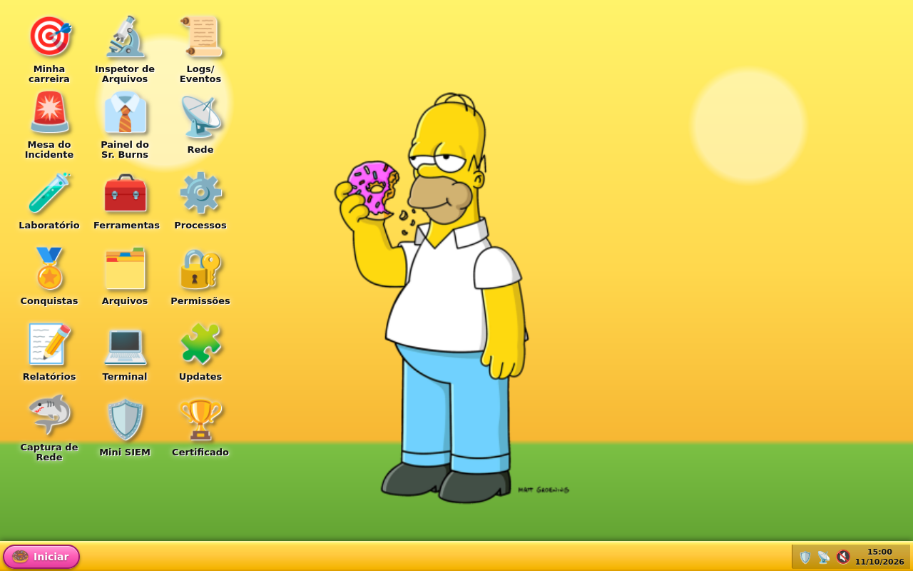

## Formatos

| Formato | Arquivo | Para quê |
| --- | --- | --- |
| Disco para VMware | `vm/dohsec-os.vmx` | **o jeito recomendado**: sistema instalado, progresso salvo entre reinícios |
| ISO live | `dohsec-os-amd64.hybrid.iso` | testar em qualquer VM ou pendrive (Ventoy); roda da memória e não guarda nada ao desligar |
| WSL | `dohsec-os.wsl` | terminal e Laboratório dentro do Windows |

Os três saem do mesmo código com `build.sh` (veja [Gerar](#gerar)).

## Como é

O boot vai direto para o **D'OH!BIOS** e para a tela de login do esboço. Não tem menu de boot nem
desktop genérico: o front é a sessão gráfica (Firefox em modo quiosque, sobre o xfwm4), e cada app
conversa com o sistema real por um serviço local (`dohsec-api`).

| | |
| --- | --- |
| 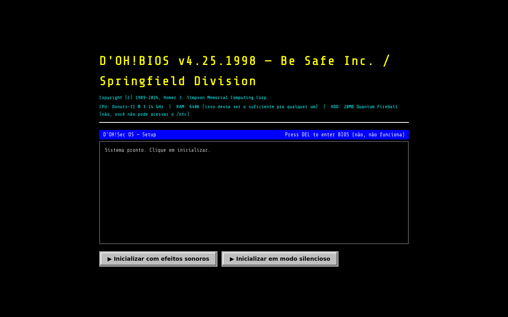 | 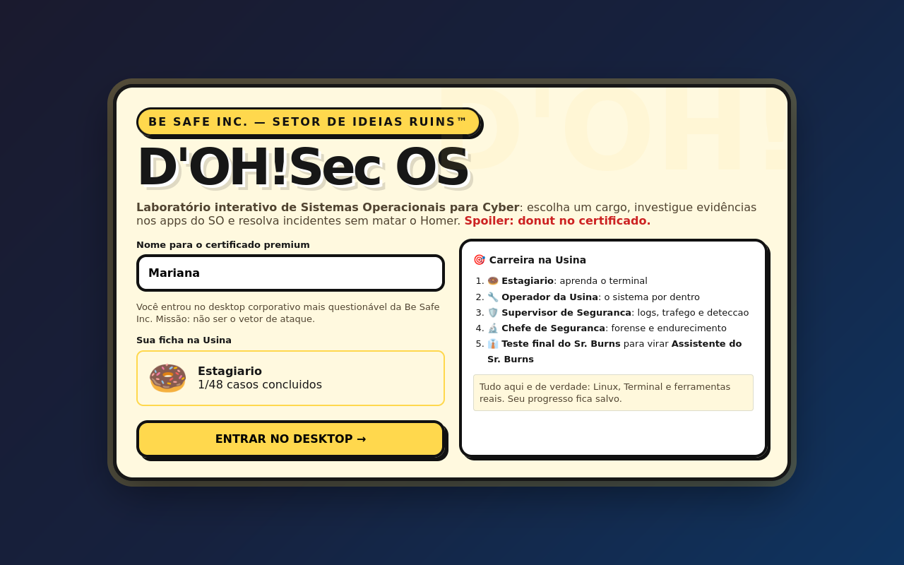 |
| **D'OH!BIOS**: a primeira tela depois do boot | **Login**: nome para o certificado e a ficha na Usina |

### Apps do sistema (todos reais)

| App | O que mostra ou faz |
| --- | --- |
| 💻 Terminal | bash de verdade (xterm.js); também abre com **Ctrl+Alt+T** |
| 🗂️ Arquivos | navega pelas pastas, mostra arquivos e abre no Inspetor |
| ⚙️ Processos | `ps` ao vivo; encerra os processos do próprio usuário |
| 📡 Rede | `ip`, rotas, `ss` (portas e conexões) e DNS |
| 📜 Logs/Eventos | `journalctl`: sistema, logins e sudo, avisos, kernel |
| 🛡️ Mini SIEM | busca no journal, em `/var/log` e nas evidências dos casos |
| 🔐 Permissões | `id`, contas, `sudo -l`, `ls -la ~` e programas SUID |
| 🧩 Updates | pacotes pendentes e atualização pelo Terminal |
| 🔌 Reiniciar / Desligar | pelo menu Iniciar |

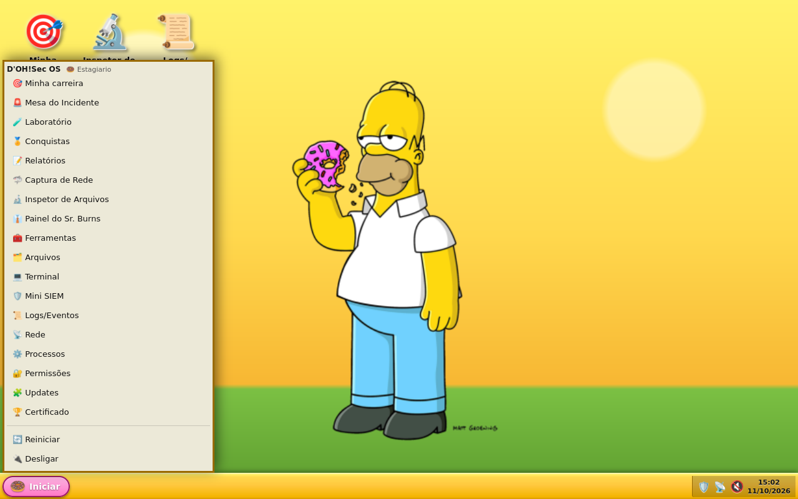

### Exclusivos do D'OH!Sec

| | |
| --- | --- |
| 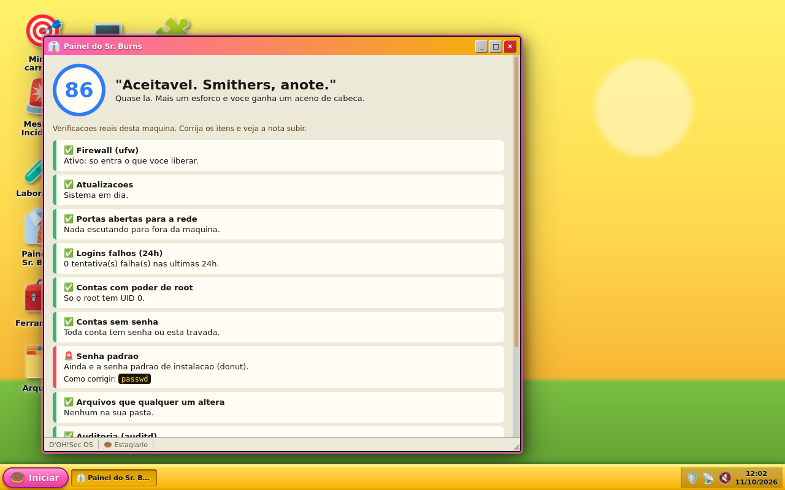 | 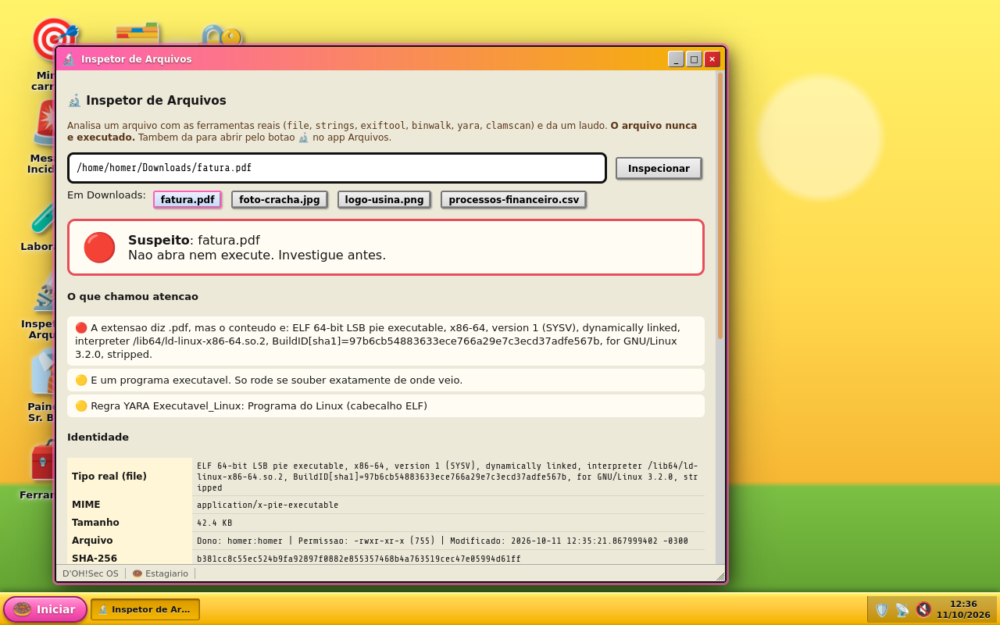 |
| **👔 Painel do Sr. Burns**: nota de segurança da própria máquina (firewall, updates, portas expostas, logins falhos, UID 0, contas sem senha, senha padrão, arquivos graváveis, auditd, AIDE), com botão de corrigir. Só verifica e corrige: nunca enfraquece nada. | **🔬 Inspetor de Arquivos**: laudo de um arquivo suspeito com `file`, `strings`, `exiftool`, `binwalk`, YARA e ClamAV, sem nunca executá-lo. Pega extensão falsa, extensão dupla, arquivo embutido e metadados. |
| 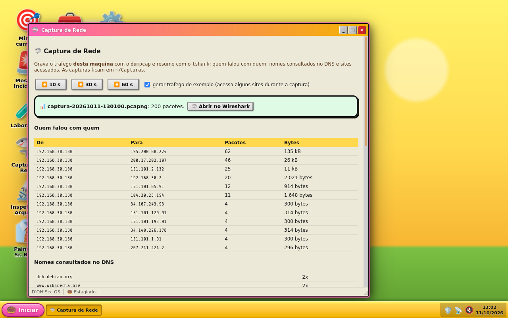 | 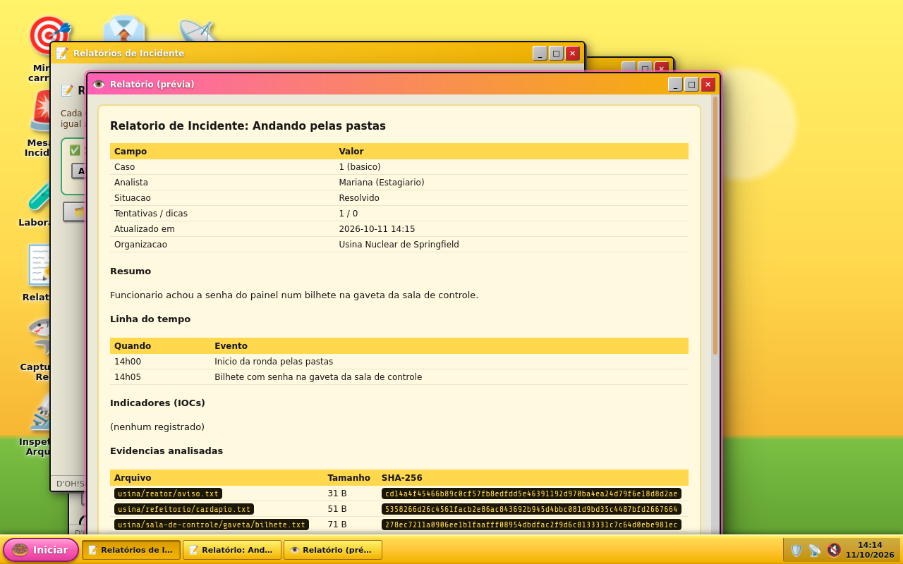 |
| **🦈 Captura de Rede**: grava 10, 30 ou 60 segundos com `dumpcap` e resume com `tshark` (quem falou com quem, DNS, sites HTTPS e HTTP). Abre no Wireshark com um clique. | **📝 Relatório de Incidente**: diário do analista em cada caso, mais resumo, linha do tempo, IOCs, impacto, remediação e lições. As evidências entram sozinhas com SHA-256. Exporta Markdown e HTML para `~/Relatorios`. |
| 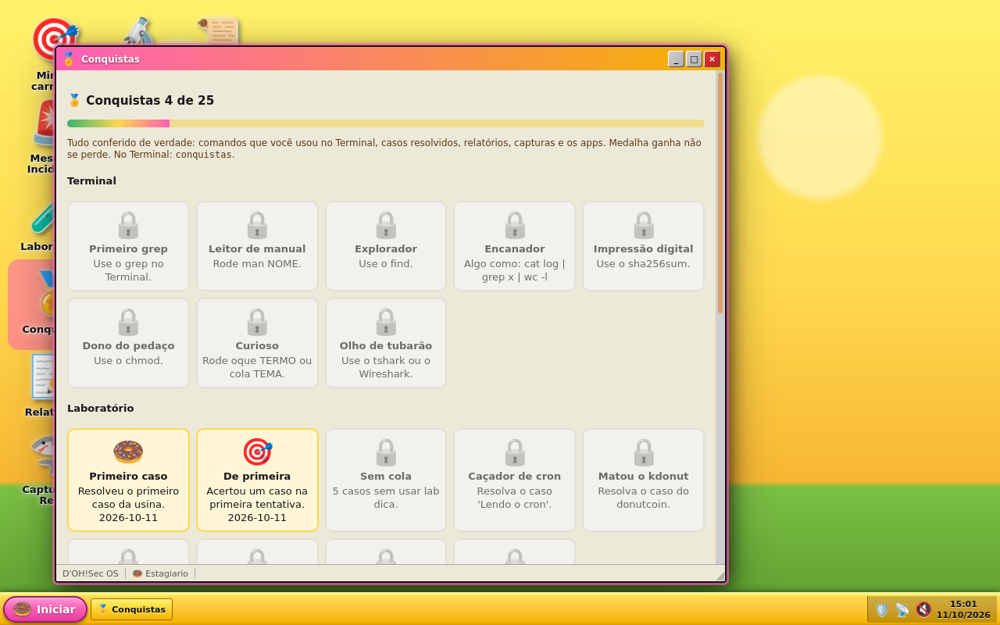 | 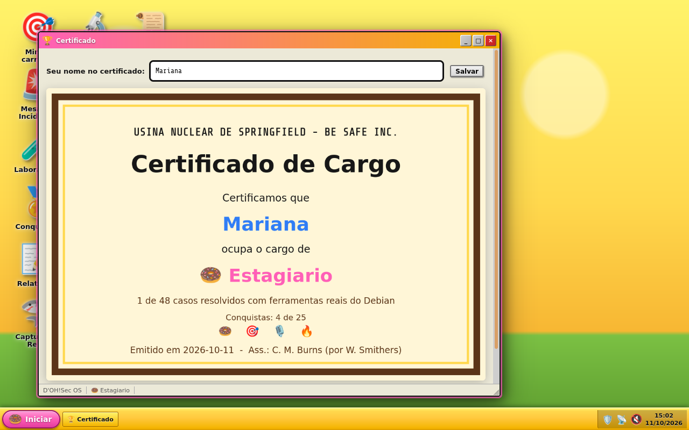 |
| **🏅 Conquistas**: 25 medalhas ganhas de verdade (comandos do terminal, casos, relatórios, capturas e apps). Aparecem num aviso na tela, na ficha e no certificado. | **🏆 Certificado**: o cargo atual, os casos resolvidos e as medalhas. Salva em PNG. |

## Carreira na Usina

Você entra como **Estagiário** e vai sendo promovido(a) resolvendo casos reais. As etapas liberam em
ordem, cada promoção chega por memorando do Smithers e o progresso fica salvo
(`~/.local/share/dohsec/lab.json`).

| Cargo | Etapa | Casos |
| --- | --- | --- |
| 🍩 Estagiário | o terminal | 8 |
| 🔧 Operador da Usina | o sistema por dentro | 13 |
| 🛡️ Supervisor de Segurança | logs, tráfego e detecção | 15 |
| 🔬 Chefe de Segurança | forense e endurecimento | 9 |
| 👔 Assistente do Sr. Burns | Teste final do Sr. Burns | 3 |

| | |
| --- | --- |
| 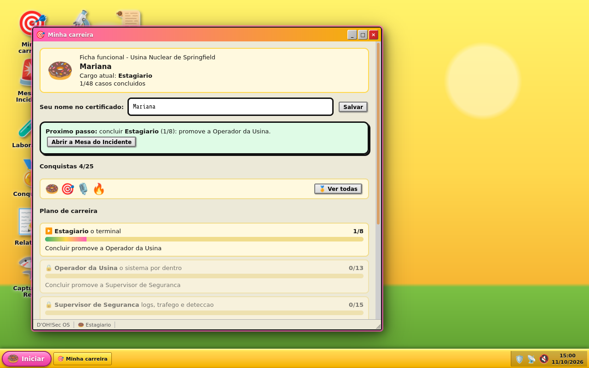 | 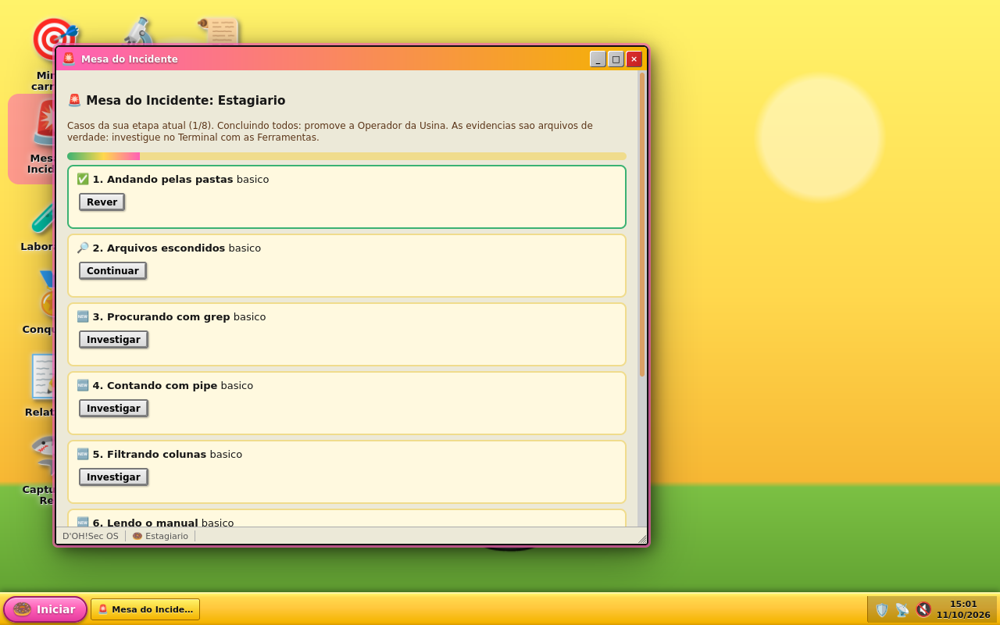 |
| **🎯 Minha carreira**: ficha funcional, plano de carreira, medalhas e histórico de promoções | **🚨 Mesa do Incidente**: os casos da etapa atual |

## Laboratório Springfield

Casos de resposta a incidente da Usina com evidências de verdade para investigar no terminal: logs de
SSH e de firewall, e-mails com cabeçalhos, capturas `.pcap`, CSVs de eventos do Windows e do Sysmon,
`docker inspect`, crontabs, `sudo -l`, imagens com metadados e arquivos embutidos, relatórios do AIDE
e do auditd. Tudo é sintético: IPs de documentação (RFC 5737), domínios `.test` e nenhum binário malicioso.

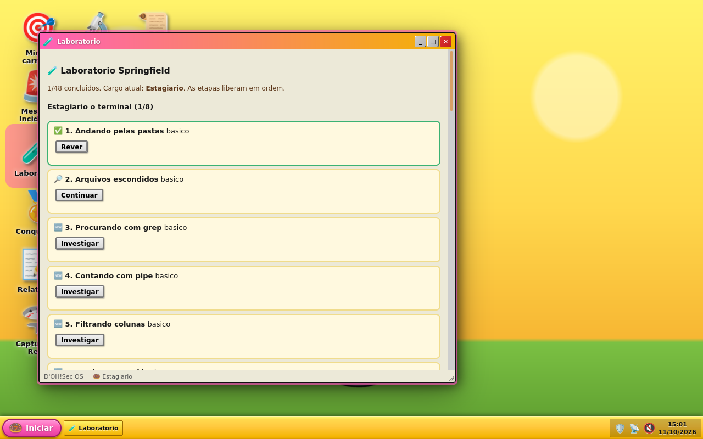

| Comando | O que faz |
| --- | --- |
| `lab` | lista os casos, o progresso e o cargo atual |
| `lab iniciar 1` | copia as evidências do caso para `~/springfield/casos/` e mostra o contexto |
| `lab dica 1` | mostra a próxima dica |
| `lab responder 1 "resposta"` | confere a resposta (maiúsculas, aspas e espaços não importam) |
| `lab revisar 1` | mostra o que aprendemos no caso |
| `lab zerar` | apaga o progresso |

As ferramentas instaladas para resolver os casos: `grep`, `awk`, `jq`, `sqlite3`, `file`, `xxd`,
`strings`, `sha256sum`, `tcpdump`, `tshark`, Wireshark, `nmap`, YARA, ClamAV, `exiftool`, `binwalk`,
`foremost`, Sleuth Kit, `testdisk`, `lynis`, `auditd`, AIDE, `ufw`, `nftables`, Suricata e Scapy.
O app **🧰 Ferramentas** mostra o que usar em cada etapa.

As respostas ficam no `casos.json` só como hash. Para criar ou mudar casos, edite
`scripts/gen-lab.py`, `scripts/lab_casos.py` ou `scripts/lab_esboco.py` e rode `python3 scripts/gen-lab.py`.
Cada caso novo deve ter a própria semente (veja `lab_esboco.py`) para não mudar as respostas dos outros.

## Comandos do terminal

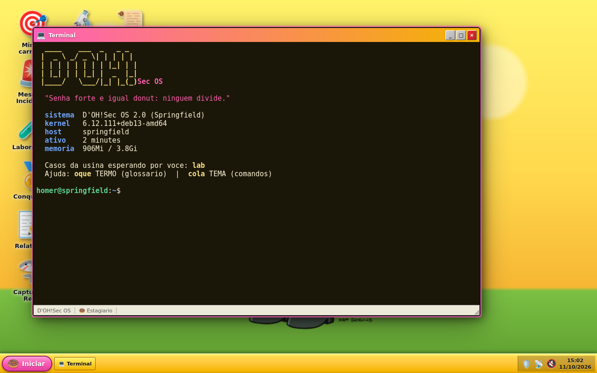

| Comando | O que faz |
| --- | --- |
| `doh` | banner com frase aleatória e resumo da máquina |
| `oque TERMO` | glossário sem jargão: `oque firewall`, `oque hash` (aceita sem acento e só o começo) |
| `cola TEMA` | os comandos mais úteis por tema: `cola rede`, `cola forense`, `cola tudo` |
| `lab` | o Laboratório Springfield (acima) |
| `relatorio anota "pista"` | anota no diário do caso (dentro da pasta do caso o número é opcional) |
| `relatorio ver N` / `exportar N` | mostra ou exporta o relatório do caso |
| `conquistas` | as medalhas ganhas e o que falta |
| `donut` | donut 3D girando |
| `noturno on` / `off` / `auto` | papel de parede noturno com estrelas piscando (só na ISO e no disco) |

## Rodar no VMware

1. **Player → File → Open...** e escolha `vm/dohsec-os.vmx`.
2. **Play**. O sistema entra direto, sem pedir senha (usuário `homer`, senha `donut`; troque com `passwd`).

A VM usa UEFI, 4 GB de RAM e 2 CPUs. Para levar as mudanças do código para uma VM já criada sem perder
o progresso, ligue a VM e rode `scripts/atualiza-vm.sh` no Git Bash: ele copia programas, front e
casos, e reinicia a VM.

## Rodar a ISO

Em qualquer VM (Hyper-V, VirtualBox, VMware) com 4 GB de RAM, aponte o CD para a ISO. No QEMU:

```bash
qemu-system-x86_64 -m 4096 -enable-kvm -cdrom dohsec-os-amd64.hybrid.iso
```

A ISO roda da memória: ao desligar, o progresso some. Para guardar, use o disco do VMware.
Se a VM mostrar "Network boot from Intel E1000", ela não achou a ISO no CD: confira o caminho do
arquivo nas configurações do CD (e não troque a ISO com a VM suspensa).

## Instalar no WSL

Dois cliques no `dohsec-os.wsl`, ou:

```bash
wsl --install --from-file dohsec-os.wsl
```

Precisa do WSL 2.4.4 ou mais novo. Vem com o terminal temático, o Laboratório, `oque`, `cola`,
`relatorio` e `conquistas`; o front do esboço abre no Windows com `academy` (WSLg). As ferramentas de
análise não vêm na imagem do WSL: instale as que precisar com `sudo apt install`.

## Gerar

Roda em qualquer Linux com root ou `sudo`, inclusive no WSL do Windows (Ubuntu serve):

```bash
wsl -d Ubuntu -u root -- bash /mnt/c/Projetos/dohsec-os/build.sh iso
```

```bash
wsl -d Ubuntu -u root -- bash /mnt/c/Projetos/dohsec-os/build.sh wsl
```

```bash
wsl -d Ubuntu -u root -- bash /mnt/c/Projetos/dohsec-os/build.sh disco
```

Num Debian, builda direto. Em outra distro, monta antes um chroot Debian 13 em `/var/lib/dohsec-builder`
(só na primeira vez) e builda lá dentro. O resultado volta para esta pasta. O WSL leva uns 5 minutos.
A primeira ISO baixa uns 2 GB e leva de 30 a 60 minutos; as seguintes reaproveitam o cache.
O `disco` precisa de uma ISO gerada antes e cria `vm/dohsec-os.vmdk` e `vm/dohsec-os.vmx`.

Não rode o build com uma VM ligada na mesma máquina: os dois juntos podem esgotar a memória.

## Segurança

- O `dohsec-api` escuta só em `127.0.0.1:7700`, roda como o usuário da sessão (nunca root) e exige um
  token sorteado a cada sessão e o cabeçalho `Host` correto (contra DNS rebinding).
- O terminal do front (`dohsec-pty`) escuta só em `127.0.0.1:7681` e confere a origem e o mesmo token.
- O Inspetor nunca executa o arquivo analisado. O Painel do Sr. Burns só verifica e endurece.
- No disco do VMware, o `homer` usa `sudo` sem senha para facilitar o laboratório. Não use essa
  imagem como máquina de produção.

## Estrutura

- `config/includes.chroot/` - arquivos comuns aos formatos: front, apps, comandos, casos, arte
  - `usr/share/dohsec/academy/index.html` - o front do esboço
  - `usr/share/dohsec/front/` - a ponte (`bridge.js`, `bridge.css`) que liga o front ao sistema
  - `usr/local/bin/` - `dohsec-api`, `dohsec-pty`, `dohsec-shell`, `lab`, `oque`, `cola`, `relatorio`, `conquistas`...
  - `usr/share/dohsec/lab/` - os casos gerados (evidências e `casos.json`)
- `config/package-lists/`, `config/hooks/live/`, `auto/config` - ISO (live-build)
- `config/bootloaders/` - boot da ISO (sem menu, direto para o sistema)
- `config/wsl/` - só do WSL: pacotes, primeiro uso, ícone, perfil do Terminal
- `config/vm/dohsec-os.vmx` - modelo da VM do VMware
- `scripts/gen-lab.py`, `lab_casos.py`, `lab_esboco.py` - geram os casos do Laboratório
- `scripts/gen-xfwm4-theme.py`, `gen-ceu-noturno.py` - bordas das janelas e céu noturno
- `scripts/build-wsl.sh`, `build-disco.sh`, `debian-builder.sh` - montagem de cada formato
- `scripts/atualiza-vm.sh` - leva o código novo para a VM sem recriar o disco
- `build.sh` - ponto de entrada (`iso`, `wsl` ou `disco`)
- `docs/prints/` - os prints deste README

## Próximos passos

- Ferramentas de análise também na imagem do WSL
- Instalador (Calamares) para instalar em disco físico
- Imagem para Hyper-V e VirtualBox (`.vhdx`, `.vdi`)
- Cursor e sons próprios
